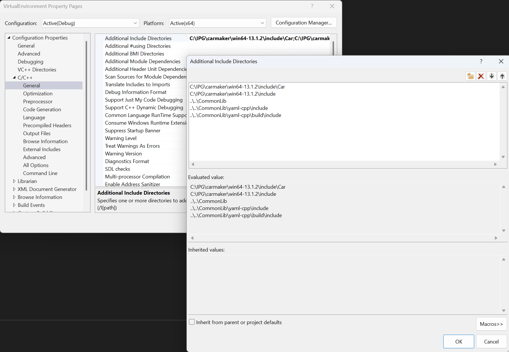
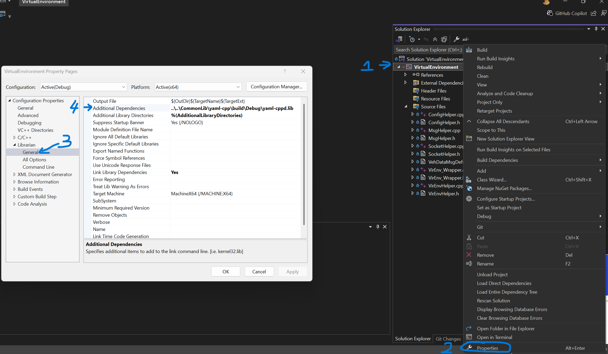
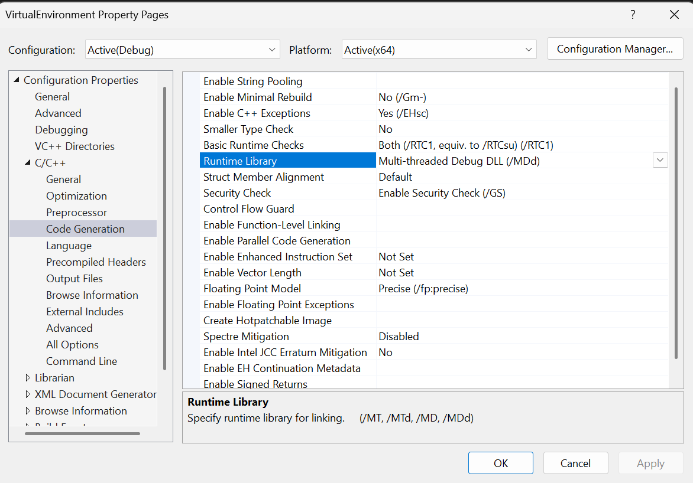
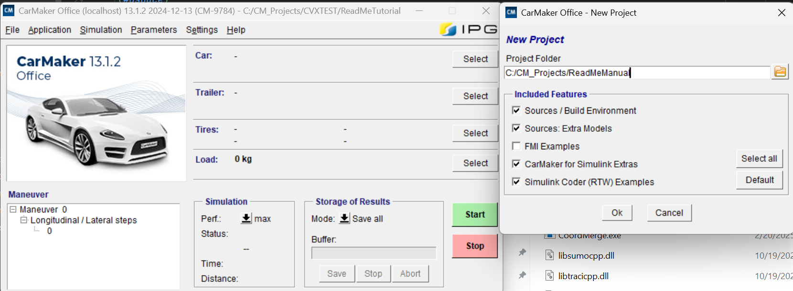
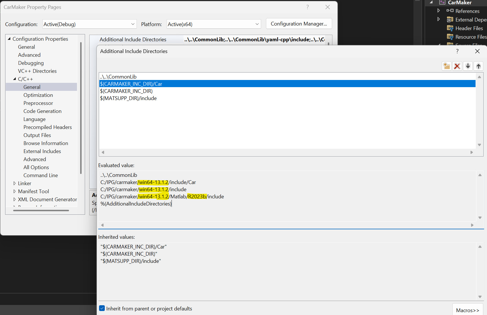
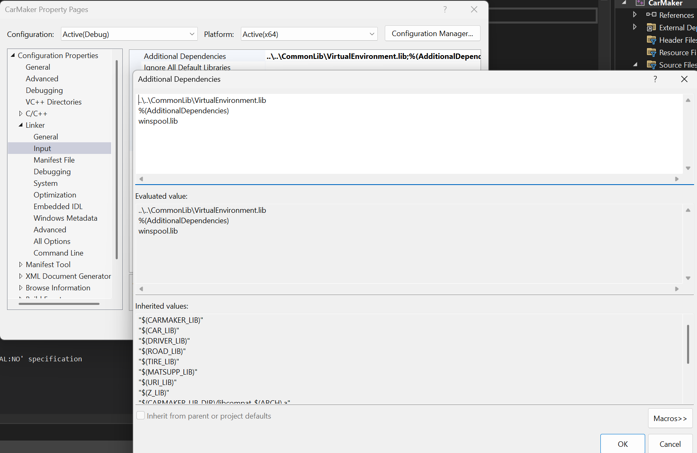
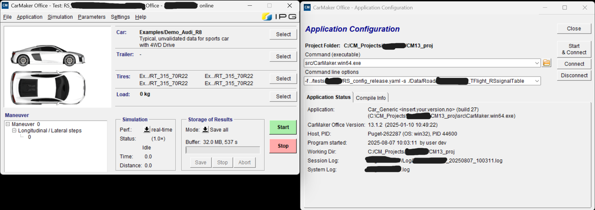
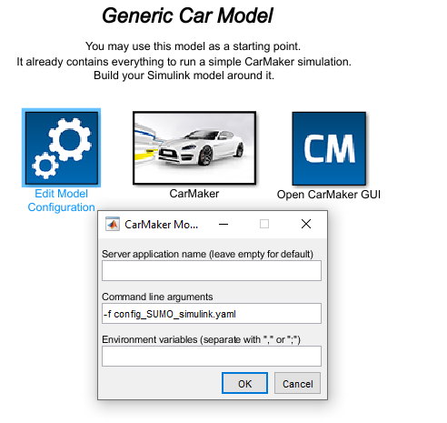
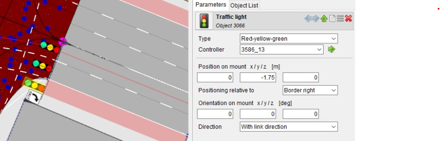
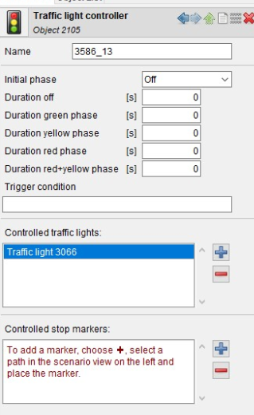

# RealSim CarMaker Documentation

Please start with reading through the documentation, and playwith included Examples.

## Table of Contents
<!-- TOC -->
* [Simulation Setups](#simulation-setups)
  * [Setup CarMaker Office or CarMaker Simulink](#setup-carmaker-office-or-carmaker-simulink)
  * [Obtain CarMaker Executables](#obtain-carmaker-executables)
    * [Pre required library](#pre-required-library)
    * [Compile Source Codes](#compile-source-codes)
  * [Run CarMaker office](#run-carmaker-office)
  * [Run CarMaker-Simulink](#run-carmaker-simulink)
  * [Setup CM dSPACE](#setup-cm-dspace)
* [Setup Application](#setup-application)
  * [SUMO](#sumo)
  * [VISSIM](#vissim)
* [Run Simulations](#run-simulations)
  * [General Setups](#general-setups)
  * [dSPACE](#dspace)
  * [Examples](#examples)
<!-- TOC -->

## Simulation Setups

### Setup CarMaker Office or CarMaker Simulink
* Note: this tutorial is based on CM13.1.3 and Matlab/Simulink 2024a (CM11.1.2 also supported).\
  Make sure you followed the main page README.md, ensuring you have MS Visual Studio installed, and pre-required libs build.
* Note: make sure your pre-required libs build Release/Debug is constant with your `VirtualEnvironment.lib` build and CarMaker executable build Release/Debug.
* Note: For automated builds, see [BUILD.md](BUILD.md) - the dispatch system automatically handles CarMaker compilation for all versions defined in `dependencies.yaml`.

### Obtain CarMaker Executables
1. RealSim contained compiled CarMaker executables, i.e., CarMaker.win64.exe for Office version, and libcarmaker4sl.mexw64 for Simulink version. Three different versions are supported, CarMaker 11, 10 and 9. Users can directly use these executables without need to recompile source codes. The executables are inside the corresponding folders ```CM11```, ```CM10```, ```CM9```.


2. Another option is that users can modify the CarMaker User.c by themselves and include necessary source codes of RealSim. Corresponding Visual Studio project files are provided and users can use their own IDE as well.
   Here we use CarMaker/TruckMaker 13 as example. If you choose this method, continue reading.
#### Pre required library

- VirtrualEnvironment.lib

To simplify CarMaker project build process, we will build a library called VirtrualEnvironment.lib that contains all the
required helper functions. Open [VirtualEnvironment.sln](../VirtualEnvironment/VirtualEnvironment.sln)
inside the VirtualEnvironment folder using Visual Studio 2022. in Visual Studio 2022, find the solution explorer window on the right of the screen, right click the _VirtualEnvironment_, select _Properties_,
Then in the Property Page, find C/C++ -> General -> Additional Include Directories. Edit the carmaker version if necessary. And make sure yaml-cpp are included:


Now you can build.

You should get VirtualEnvironment.lib (Release ver)
in the `./x64/Release/` folder. Note if you want to build Debug version, you need to change the linker pointed to `yaml-cpp.lib` (Release version)
to `yaml-cppd.lib` (Debug version) that you build previously.

Note: To build Debug version, in Visual Studio 2022, find the solution explorer window on the right of the screen, right click the _VirtualEnvironment_, select _Properties_, Then in the Property Page, find Librarian -> General -> Additional Dependencies.
Type in the location of where you build the yaml-cppd.lib. Then under C/C++ -> Code Generation -> Runtime Library, set it to Multi-threaded Debug DLL (/MDd). And then build the solution in Debug version\
\


#### Compile Source Codes

- If you want to set up a project outside the cloned FIXS repo, you first need to create a **parent folder**. Copy the [CarMaker](../CarMaker)
  [CommonLib](../CommonLib) [tests](../tests) folders into the **parent folder**.
  Next, create a project folder in the **parent folder** (File -> Project Folder -> Create Project).
  

- If you want your project to be inside the FIXS repo, just create a project right under the FIXS folder.

After creating the project folder, there will be a **src** folder and **src_cm4sl/src_tm4sl** folder: edit src folder if only for office version (no need Simulink or HIL), otherwise use src_cm4sl folder.
In the selected folder, use **Microsoft Visual Studio 2022** to open a .sln file. Upon opening a project, proceed to source code compilation.


There is **app_tmp.c, CM_Main.c, CM_Vehicle.c, IO.c, and USer.C** files in the created project.


- Define the dependencies folders\
  In C/C++ -> General -> Additional Include Directories, exam the Evaluated value, make sure the CarMaker verison and CarMaker support Matlab version are correct.

  
  - tips: Matlab version is inherited from (MATSUPP_DIR), this value can be modified from the `CarMaker.prop` file in `src` folder.
    change the version in ```<MATSUPP_MATVER> xxx </MATSUPP_MATVER>``` accordingly.


- Define libraries\
  In Linker -> Input -> Additional Dependencies, add `VirtualEnvironment.lib`
  

Next, modify the User.cpp to include the following codes
- At beginning of the file, add the followings, ``need to make sure VirEnv_Wrapper.h is included before including the windows.h!``
```c++
...
#define REALSIM

#ifdef REALSIM 
// ===========================================================================
// 			 RealSim 
// ===========================================================================
#include "VirEnv_Wrapper.h"

struct VirEnvHelper* VirEnv_c;

char* RS_configFile;
char* RS_signalTable;
// ===========================================================================
// ===========================================================================
#endif

#include <Global.h>

#if defined(WIN32)
# include <windows.h>
#endif
...
```

- Modify User_ScanCmdLine
```c++
char **
User_ScanCmdLine (int argc, char **argv)
{
    const char *Pgm = argv[0];

    /* I/O configuration to be used in case no configuration was
       specified on the command line. */
    IO_SelectDefault("default" /* or "demoapp", "demorbs,demofr" etc. */);

    while (*++argv) {
	if (strcmp(*argv, "-io") == 0 && argv[1] != NULL) {
	    if (IO_Select(*++argv) != 0)
		return NULL;
	} 
    else if (strcmp(*argv, "-h") == 0 || strcmp(*argv, "-help") == 0) {
	    User_PrintUsage(Pgm);
	    SimCore_PrintUsage(Pgm); /* Possible exit(), depending on CM-platform! */
	    return  NULL;
    }
    // ===========================================================================
    // 			 RealSim 
    // ===========================================================================
    else if (strcmp(*argv, "-f") == 0) {
		RS_configFile = *++argv;
	}
	else if (strcmp(*argv, "-s") == 0) {
		RS_signalTable = *++argv;
	}
    // ===========================================================================
    // ===========================================================================
    else if ((*argv)[0] == '-') {
	    LogErrF(EC_General, "Unknown option '%s'", *argv);
	    return NULL;
	} else {
	    break;
	}
    }

    return argv;
}
```
- Modify User_Init
```c++
int
User_Init (void)
{
#ifdef REALSIM
    // ===========================================================================
    // 			 RealSim 
    // ===========================================================================
    VirEnv_c = newVirEnvHelper();
    // ===========================================================================
    // ===========================================================================
#endif
    return 0;
}
```
- Modify User_TestRun_Start_atEnd
```c++
int
User_TestRun_Start_atEnd (void)
{
#if defined(XENO)
    IOConf_DeclQuants();
#endif

#ifdef REALSIM
    // ===========================================================================
    // 			 RealSim 
    // ===========================================================================	   
    if (VirEnv_isVeryFirstStep && SimCore.State >= SCState_Start) {
        VirEnv_initialization(VirEnv_c, RS_configFile, RS_signalTable);
    }
    // ===========================================================================
    // ===========================================================================
#endif

    return 0;
}
```

- Modify User_Calc
```c++
int
User_Calc (double dt)
{
    /* Starting with CM 6.0 User_Calc() will be invoked in EVERY simulation
       state. Uncomment the following line in order to restore the behaviour
       of CM 5.1 and earlier. */
    /*if (!UserCalcCalledByAppTestRunCalc) return 0;*/

#ifdef REALSIM
    // ===========================================================================
    // 			 RealSim 
    // ===========================================================================
    if (SimCore.State != SCState_Simulate) {
        return 0;
    }
	
    VirEnv_runStep(VirEnv_c, SimCore.Time);
	
    // ===========================================================================
    // ===========================================================================
#endif

    return 0;
}
```
- Modify User_TestRun_End
```c++
int
User_TestRun_End (void)
{
#ifdef REALSIM
	// ===========================================================================
    // 			 RealSim 
    // ===========================================================================
	VirEnv_shutdown(VirEnv_c);
    // ===========================================================================
    // ===========================================================================
#endif 

    return 0;
}
```

Before compiling, right-click 'CarMaker for Simulink' -> Property -> C++ -> General -> Set "Treat warnings as errors" to "No".

Build CarMaker for Simulink: CTRL + B

After compiling, the executable should be in **src** or **src_cm4sl** folder. In **src**, it should be **CarMaker.win64.exe**; in **src_cm4sl**, it should be **libcarmaker4sl.mexw64**.

### Run CarMaker office
Open CarMaker Office, chose Application -> Application Configuration\
Make sure select the compiled ```CarMaker.win64.exe```  in the `Command (executable)` and specify `Command line options`
to the desired config.yaml file, and (optional) signal light sync table file

Note:  `-f` to point to the yaml config file for SUMO, `-s` to point signal light sync table between SUMO and CarMaker.
Using either relative path to the working directory or absolute path are OK



### Run CarMaker-Simulink
Open the CarMaker simulink model, double click `Edit Model Configuration`, if the compiled libcarmaker4sl.mexw64 is in the
search directory (you can be checked by ```which libcarmaker4sl.mexw64``` inMatlab), you can leave the `Server application name` empty,
otherwise you can type in the .mexw64 location manually. Then, specify command line options to the desired config.yaml file, and (optional) signal light sync table file

Note:  `-f` to point to the yaml config file for SUMO, `-s` to point signal light sync table between SUMO and CarMaker.
Using either relative path to the working directory or absolute path are OK




```CM11_proj\src_cm4sl\RealSimGeneric.mdl```  is a good example simulink model to develop user applications

### Setup CM dSPACE

Building and running CarMaker on dSPACE SCALEXIO (RealSim dSPACE library,
`CM_BuildConfig.py`, ConfigurationDesk, target configuration file) is covered in
[dSPACEDoc: CarMaker on dSPACE](dSPACEDoc.md#carmaker-on-dspace). The `User.c` changes are the same
as above except for the configuration-file path; see
[dSPACEDoc: Configuration file on the target](dSPACEDoc.md#configuration-file-on-the-target).

## Setup Application

### SUMO
The SUMO network files can be put at a different location than the RealSim folder and CarMaker folder. It is recommended to create a batch file for each different simulation runs and setups. This batch file can be inside the ##YOUR CM Project##\src_cm4sl folder or inside your SUMO network file folder. The corresponding path to RealSim, SumoApp, and CmProj need to be change accordingly. Also, example below runs the python script in a conda environment, it is up to the user to setup a python environment properly. The only non-standard python library is ```pyyaml```. Below is an example:
```batch
set RealSimPath=..\..\
set RealSimAppPath=.\sumoFiles
set configFilename=RS_config_release.yaml
set CmProjPath=..\..\CM11_proj

start sumo-gui -c %RealSimAppPath%\ShallowfordRd_RL.sumocfg --remote-port 1337 --step-length 0.1 --start --begin 39600

start cmd /c %RealSimPath%\TrafficLayer.exe -f %configFilename%

call conda activate realsimdev
python %RealSimPath%\CarMaker\RealSimSetCarMakerConfig.py --cm-project-path %CmProjPath% --configFile %configFilename% --signal-table-path %CmProjPath%\Data\Road\RS_ShallowfordRd_sumo_signal_RSsignalTable.csv
call conda deactivate

pause
```

### VISSIM

> **Status (2026-06-05):** CarMaker-VISSIM co-simulation is a Milestone 0.9.0
> deliverable, tracked by [#101](https://github.com/ORNL-Real-Sim/FIXS/issues/101)
> (`VirtualEnvironment.lib` changes) and **gated on
> [#156](https://github.com/ORNL-Real-Sim/FIXS/issues/156)**, the design ticket
> for the VISSIM DLL path (DriverModel.dll vs DrivingSimulator.dll) and the
> signal-routing decision. The instructions below will be filled in once #156
> lands and a runnable scenario is built under [tests/Vissim/Ipg/](../tests/Vissim/Ipg/).

The CarMaker side of the FIXS bridge (`VirtualEnvironment.lib`) consumes
`VehFullData_t` over a TrafficLayer socket and is largely
**traffic-simulator-agnostic at runtime** — the bulk of the CarMaker-VISSIM
integration sits in TrafficLayer + `TrafficHelper`, not in this library.

Once #156's design lands, this section will cover:
- `CarMakerSetup` parameters specific to a VISSIM-backed TrafficLayer (any
  required differences from the SUMO setup above).
- The launcher template for VISSIM 2022 + TrafficLayer + CarMaker, including
  the dispatch-soft-reset playbook (see [CLAUDE.md](../CLAUDE.md) "VISSIM 2022
  dispatch on Win11 24H2").
- Signal-light synchronization between VISSIM signal controllers and CarMaker
  traffic-light objects, including the signal-table format finalized by #156.

Until then, see [tests/Vissim/Ipg/README.md](../tests/Vissim/Ipg/README.md) for
the current (stale, non-runnable) dock point and what is missing.

## Run Simulations

### General Setups
**Generate Traffic Objects**

RealSimCarMakerSetup.py will modify an existing testrun file and add traffic objects to it. use ```RealSimCarMakerSetup.py --help``` to check all detailed arguments. Below is an example to read a "coordMerge_sumo" testrun and output a "coordMerge_sumo_rs_simulink" testrun with 10 cars and 10 trucks. Based on the version of testrun files, the script will search through CarMaker installation path and use existing vehicle .mobj files to create random traffic. ```RealSimCarMakerSetup.py --no-random-traffic``` can be set to disable random traffic, then all traffic objects will use the same vehicle.
```
RealSimCarMakerSetup.py --cm-project-path ../CM10_Proj --testrun coordMerge_sumo --cm-install-path C:\IPG --output-testrun coordMerge_sumo_rs_simulink --car 10 --truck 10
```

After traffic objects are generated, **do not** modify their "Name" otherwise Real-Sim may not work properly. But feel free to modify the "Movie geometry" to another vehicle .mobj file. If SUMO vehicle is of vehicle class: "car", "passenger", "private", it will be rendered as a car in CarMaker. If SUMO vehicle is of class "truck", it will be rendered as a truck in CarMaker. All other vehicle classes are not currently supported.

**Create lookup table to synchronize SUMO and IPG traffic signal lights**

- Currently, traffic signal lights have to be manually created in CarMaker. Each signal light should be associated with a traffic light controller in the Scenario Editor. This traffic light controller has to be named with the following convention
```
<SUMO TLS id>_<SUMO signal index>
```
Also, all timing of the traffic light controller should be set to ```0```, and initial phase to be ```off```. An example is shown below



- Then, the same script above can take an additional argument to read a SUMO file and link the signal light between SUMO and IPG CarMaker:
```
RealSimCarMakerSetup.py --cm-project-path ../CM10_Proj --testrun coordMerge_sumo --cm-install-path C:\IPG --output-testrun coordMerge_sumo_rs_simulink --car 10 --truck 10 --sumo-file-path .\\tests\\SignalIpg\\sumoFiles\\ShallowfordRd_RL.net.xml

```
Then, a ```<SignalTable>.csv``` will be automatically created. By default, it will be in the ```CM11_proj\Data\Road``` folder.


**Setup config.yaml**

All the settings are pretty much similar to other Real-Sim simulation setups. Here, the following "VehicleMessageField" are mandate, otherwise errors will pop up:
```id, speed, vehicleClass, heading, grade, speedDesired```.

There is a new configuration section called ```CarMakerSetup```. Inside it, users can name the ```EgoId``` as any string of length < 50. This will be the id of the ego vehicle appears in SUMO so should be unique than other SUMO vehicles. By default, ego vehicle will have type "DEFAULT_VEHTYPE" in SUMO. If user set ego vehicle as a vehicle type belongs to truck, then it will appear as truck in SUMO. Make sure to select the same type/class of vehicle in both SUMO and CarMaker.

Below is an example ```CarMakerSetup``` section:
```yaml
CarMakerSetup:
    # whether or not enable CarMaker (default: false)
    EnableCosimulation: true
    
    # if true, ego state is sent from Simulink.
    # if false, ego state is sent from User.cpp 
    EnableEgoSimulink: false
    
    # Ip and Port settings 
    # if no setting, need to make sure have one and only one vehicle id subscription, which will be used as ip and port
    # if set, will use whatever set here instead of what is defined in subscription
    CarMakerIP: 160.91.113.184
    
    CarMakerPort: 7331
    
    # refresh rate, default Traffic Objects updates every 0.001 seconds.
    # This is how often traffic poses are RE-APPLIED to CarMaker - NOT how often FIXS
    # exchanges with TrafficLayer. That exchange is a fixed 0.1 s (fixs::kFeedPeriodS),
    # and the core interpolates each sample across the sub-steps in between -
    # position, heading and grade - so 0.001 here means smooth 1 kHz traffic motion
    # off a 10 Hz feed, not a 1 kHz SUMO.
    TrafficRefreshRate: 0.001
    
    # ego settings
    # if no setting, need to make sure have one and only one vehicle id subscription, which will be used as ego
    # if no type, will add the vehicle using sumo default vehicle type
    # if set, will use whatever set here instead of what is defined in subscription
    EgoId: egoCm
    
    EgoType: DEFAULT_VEHTYPE

    # transmit real-time traffic signal light information 
    SynchronizeTrafficSignal: true

    TrafficSignalPort: 2444    
```
Note, in dSPACE implementation, CarMakerIP should be the IP of the host PC.


### dSPACE
See [dSPACEDoc: Run a dSPACE simulation](dSPACEDoc.md#run-a-dspace-simulation).


### Examples
The release comes with a CM11_proj folder and example SUMO applications, and Visual Studio projects to compile executables. The SUMO files are inside ```tests``` folder. The testruns can potentially be transferred to previous CarMaker versions by manually changing testrun heading to the desired version, for example,
```FileIdent = CarMaker-TestRun 11``` ==> ```FileIdent = CarMaker-TestRun 9```


<!---
## Office simulation
run SUMO and Real-Sim with ```runCoordMergeSUMO.bat```, use CarMaker testrun ```coordMerge_rs```, make sure the GUI configuration is set properly, check [Office](#office)

## Simulink simulation
run SUMO and Real-Sim with ```runCoordMergeSUMO_simulink.bat```, use CarMaker testrun ```coordMerge_rs_simulink```, use Simulink file ```CM11_proj\src_cm4sl\RealSimGeneric.mdl``` make sure the configuration is set properly, check [Simulink](#simulink).
-->
