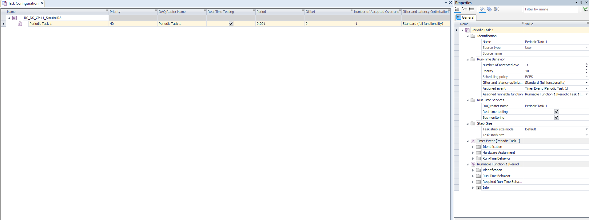
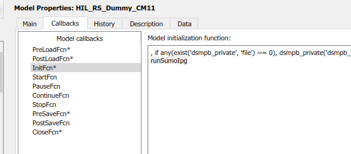
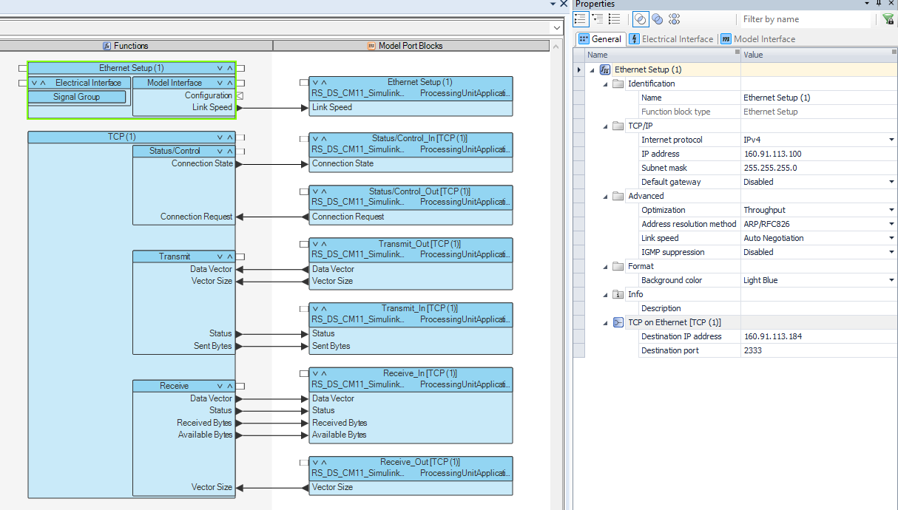
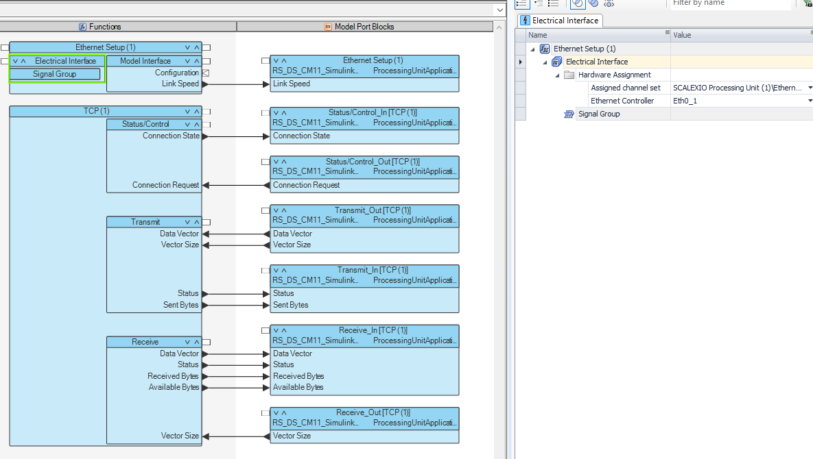
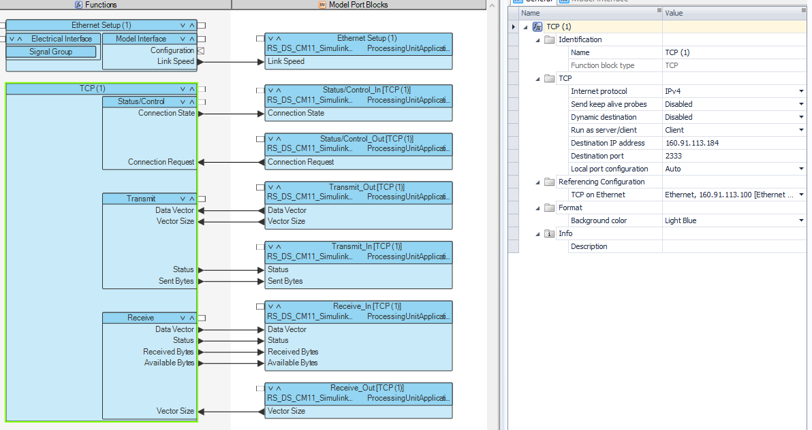
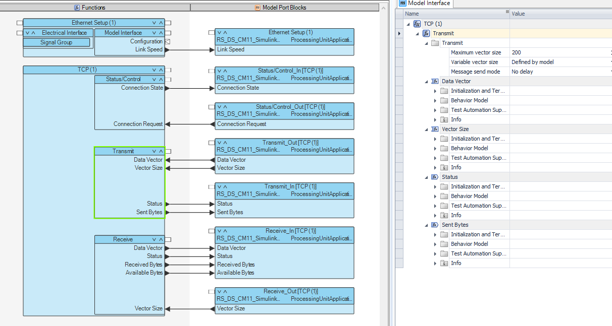
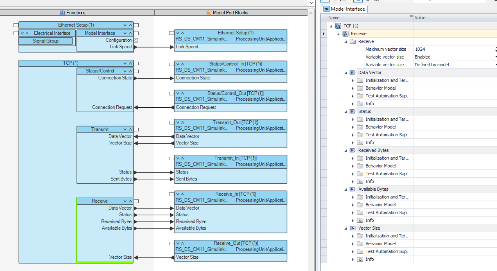
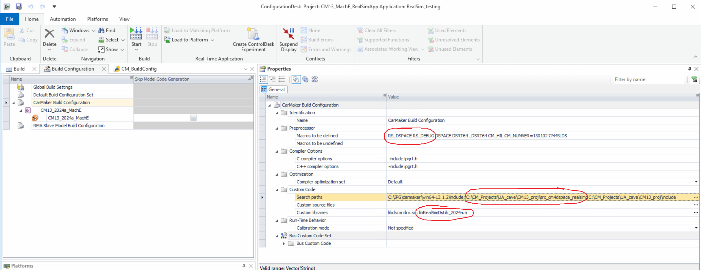

# RealSim dSPACE Documentation

This page covers running a Real-Sim FIXS client on dSPACE real-time hardware. There
are two ways to do it:

| | Plain Simulink on dSPACE | CarMaker on dSPACE |
|---|---|---|
| What runs on the target | Your Simulink model with the RealSim blocks | CarMaker for dSPACE, with FIXS in `User.c` |
| FIXS code on the target | The RealSim blocks, generated from MATLAB code | The RealSim dSPACE library (`libRealSimDsLib_*.a`) |
| Connection to TrafficLayer | A TCP function block in ConfigurationDesk | The library's own socket |
| Needs CarMaker | No | Yes |
| Needs a library build | No | Only if the release does not include it |

In both, TrafficLayer and the traffic simulator run on a host PC, and the target
connects to TrafficLayer over Ethernet. The CarMaker side of the CarMaker setup
(User.c changes, TestRuns, signal-light tables) is in [CarMakerDoc](CarMakerDoc.md).

The Simulink templates are being reworked: the RealSim blocks are to become a
Simulink library ([#110](https://github.com/ORNL-Real-Sim/FIXS/issues/110)), placed
automatically ([#107](https://github.com/ORNL-Real-Sim/FIXS/issues/107)). The
Simulink sections below describe the templates as of 0.9.0.

## Table of Contents
<!-- TOC -->
* [Scope](#scope)
* [Versions](#versions)
* [Common setup](#common-setup)
* [Plain Simulink on dSPACE](#plain-simulink-on-dspace)
  * [Start from the template](#start-from-the-template)
  * [Initialize the model](#initialize-the-model)
  * [TCP connection in ConfigurationDesk](#tcp-connection-in-configurationdesk)
  * [Run a Simulink dSPACE simulation](#run-a-simulink-dspace-simulation)
* [CarMaker on dSPACE](#carmaker-on-dspace)
  * [RealSim dSPACE library](#realsim-dspace-library)
  * [CarMaker BuildConfig for dSPACE](#carmaker-buildconfig-for-dspace)
  * [Prepare the CarMaker project](#prepare-the-carmaker-project)
  * [Configuration file on the target](#configuration-file-on-the-target)
  * [RealSim Simulink blocks in a CarMaker model](#realsim-simulink-blocks-in-a-carmaker-model)
  * [Run a dSPACE simulation](#run-a-dspace-simulation)
* [Troubleshooting](#troubleshooting)
<!-- TOC -->

## Scope

- **Hardware/tooling:** SCALEXIO, built with ConfigurationDesk. Other dSPACE
  platforms are not covered.
- **Plain Simulink:** the target runs code generated from your Simulink model. The
  RealSim blocks (`RealSimPack`, `RealSimDepack` and the rest of the "RealSim Core"
  subsystem) are MATLAB code, so they are generated along with the model. Nothing is
  compiled from `CommonLib/` C++.
- **CarMaker:** the target runs CarMaker for dSPACE, linked against the RealSim
  dSPACE library. That library is FIXS's C++ client (`SocketHelper`, `MsgHelper`,
  `VirEnvHelper`, `VirEnv_Wrapper` from `CommonLib/`) cross-compiled for SCALEXIO with
  `RS_DSPACE` defined. `VirEnvHelper.cpp` includes `<CarMaker.h>`, so one library is
  built per CarMaker version.

## Versions

Tool versions come from `dependencies.yaml`:

| Key | Value | Used for |
|---|---|---|
| `development_tools.dspace.version` | `2024a` | Library and BuildConfig file names |
| `development_tools.dspace.product` / `release` | ConfigurationDesk 2024-A / 24.1 | Informational |
| `simulators.carmaker.versions` | `13.1.3`, `11.1.2` | One library per version (CarMaker only) |
| `development_tools.matlab.version` | `2024a` | Simulink models |

## Common setup

1. **Network.** The target connects to TrafficLayer, so the host PC needs an address
   on the network SCALEXIO is on, and that address (not `127.0.0.1`) is the one the
   target is given. The host firewall must let TrafficLayer accept the connection.
2. **Overruns.** In ConfigurationDesk set the number of accepted overruns to `-1`:
   
3. **Order.** TrafficLayer is the server and the target is a client: start
   TrafficLayer (and its traffic simulator) before starting the real-time
   application.

## Plain Simulink on dSPACE

### Start from the template

`CommonLib/RealSimTemplate_dSPACE.slx` is the starting model. It contains the
"RealSim Core" subsystem, which packs your vehicle's state into a FIXS message and
unpacks the traffic TrafficLayer sends back, and the `dSPACE TCP In` / `dSPACE TCP Out`
blocks that connect it to the ConfigurationDesk TCP function block. Put your vehicle
model next to it.

`CommonLib/RealSimTemplate.slx` is the host-PC (non-dSPACE) version of the same
model; it talks to TrafficLayer through the `RealSimSocket` MEX block instead of
dSPACE TCP blocks.

### Initialize the model

The model needs the message definitions from your `config.yaml` before it is built.
Set the model's `InitFcn` to:

```matlab
% FIXS CommonLib (from a checkout or a release) and the run's config.yaml
addpath(genpath('C:\path\to\FIXS\CommonLib'))
configFilename = 'C:\path\to\your\app\config.yaml';

[VehicleMessageFieldDefInputVec, VehDataBus] = RealSimInitSimulink(configFilename);

RealSimPara = struct;
RealSimPara.speedInit = 13.5;   % initial ego speed when it enters the traffic network
RealSimPara.tLookahead = 0.1;   % 0.1 for external control; >= 0.2 when the traffic simulator drives
RealSimPara.smoothWindow = 1;   % points in the speed moving average; 1 means no averaging
```



`RealSimInitSimulink` reads `config.yaml` on the host when the model is built, using
`ReadYaml` from `CommonLib/YAMLMatlab`. The message layout (`VehicleMessageField`) is
compiled into the real-time application, so rebuild after changing it in
`config.yaml`. `RealSimInitSimulink` also returns `TrafficLayerIP` and
`TrafficLayerPort`; the dSPACE template does not use them, because on dSPACE the
address is set in ConfigurationDesk (next section).

### TCP connection in ConfigurationDesk

The template's TCP blocks map to two function blocks in ConfigurationDesk:

- **Ethernet Setup:** the SCALEXIO side. Its IP address and subnet mask are the
  target's own address on the network shared with the host; assign it to the
  Ethernet controller the cable is on.
- **TCP:** the connection to TrafficLayer. Run it as **client**, with
  **Destination IP address** = the host PC running TrafficLayer and **Destination
  port** = the port TrafficLayer listens on for this client in `config.yaml`. The
  example uses `2333`.

The example sets the Transmit maximum vector size to 200 and the Receive maximum
vector size to 1024, with variable vector sizes defined by the model.







### Run a Simulink dSPACE simulation

1. Build the application in ConfigurationDesk.
2. Start TrafficLayer and the traffic simulator on the host with the same
   `config.yaml` the model was built with.
3. Download and start the real-time application (e.g. from ControlDesk).

## CarMaker on dSPACE

### RealSim dSPACE library

#### When you need to build it

A CarMaker-for-dSPACE application that defines `REALSIM` in `User.c` always links
this library. You do **not** need to build it yourself if your release package
already contains it:

- `CommonLib/libRealSimDsLib_<dSPACE>_CM<CarMaker>.a`
- `CarMaker/CM<major>/libRealSimDsLib_<dSPACE>_CM<CarMaker>.a` (a copy next to the
  matching CarMaker executables)

These are only in a release built on a workstation with ConfigurationDesk
installed; `dispatch.bat` skips the step otherwise, and always skips it when
`RS_FIXS_AUTOMATION` is set.

Build it yourself when you change any of the four `CommonLib` sources above, need a
CarMaker version the release does not include, or use a different dSPACE release.

#### Build with 5b_carmaker_dspace.ps1

```batch
powershell -ExecutionPolicy Bypass -File scripts\dispatch\5b_carmaker_dspace.ps1
```

The same script runs as step 5b of `dispatch.bat`. What it does:

1. Reads `development_tools.dspace.version` and `simulators.carmaker.versions`
   from `dependencies.yaml`.
2. Finds ConfigurationDesk via `detect_tool_paths.ps1 -Tool dspace`: the
   alphabetically last folder named `dSPACE ConfigurationDesk*` under Program Files.
   The version in `dependencies.yaml` only names the output; it does not select the
   installation.
3. Requires `CFD_vars.bat` and `SCALEXIO\DsBuildLibrary.mk` inside that folder.
4. Uses `C:\IPG\carmaker` as the CarMaker root, overridden by
   `RS_FIXS_CARMAKER_BASE` or `CARMAKER_ROOT` (the latter wins). A CarMaker version
   without `win64-<version>\include` is skipped.
5. For each CarMaker version, runs `dsmake` from `CommonLib/`:

   ```batch
   "<ConfigurationDesk>\CFD_vars.bat" && dsmake -f "<ConfigurationDesk>\SCALEXIO\DsBuildLibrary.mk" ^
     output_filename=RealSimDsLib_<dSPACE>_CM<CarMaker> ^
     source_files="SocketHelper.cpp MsgHelper.cpp VirEnvHelper.cpp VirEnv_Wrapper.cpp" ^
     custom_cpp_options="-std=c++11 -I\"<CarMaker>\include\" -DDSRTLX -DRS_DSPACE -DRS_CAVE -DRS_DEBUG" ^
     target=Dsx86_32
   ```

   Dots in versions become underscores, e.g. `libRealSimDsLib_2024a_CM13_1_3.a`.
   `RS_DEBUG` is always defined; `RS_BUILD_CONFIG` does not apply to this library.
6. Decides success by whether the `.a` file exists, because `dsmake` can return
   non-zero on warnings. The library is moved to `build/CommonLib/`.
7. If CarMaker's `win64-<version>\CM4SL\CM_BuildConfig.py` exists, writes
   `CarMaker/RS_CM<CarMaker>_BuildConfig_<dSPACE>.py` (see
   [CarMaker BuildConfig for dSPACE](#carmaker-buildconfig-for-dspace)).

The script exits 1 if any CarMaker version failed. Run standalone, a missing
ConfigurationDesk or CarMaker version list is an error; run from `dispatch.bat`
(`-RunMode inline`) it is logged as `SKIPPED` in `build_summary.log`. During a full
`dispatch.bat`, each library is also copied to `build/CarMaker/CM<major>/`.

A successful build ends with:

```text
...
x86_64-linux-gnu-ar.exe: creating libRealSimDsLib_2024a_CM13_1_3.a
a - SocketHelper.o64
a - MsgHelper.o64
a - VirEnvHelper.o64
a - VirEnv_Wrapper.o64
library successfully built.
```

#### Build by hand with dsmake

Open a command prompt in `CommonLib/`, run `CFD_vars.bat` from the ConfigurationDesk
installation (for 2024-A: `C:\Program Files\dSPACE ConfigurationDesk 2024-A (24.1)`),
then run the `dsmake` command from step 5 with your own paths. dSPACE describes
building user libraries in its FAQ:
https://www.dspace.com/en/inc/home/support/kb/faqs/faq012.cfm.

### CarMaker BuildConfig for dSPACE

CarMaker for dSPACE reads compiler defines and libraries from a `CM_BuildConfig.py`.
`5b_carmaker_dspace.ps1` derives `CarMaker/RS_CM<CarMaker>_BuildConfig_<dSPACE>.py`
from CarMaker's own `CM4SL\CM_BuildConfig.py` with three edits:

- `CARMAKER_DIR` is set to `C:/IPG/carmaker/win64-<version>`. This is fixed and does
  not follow `RS_FIXS_CARMAKER_BASE`/`CARMAKER_ROOT`; edit it if CarMaker is
  installed elsewhere.
- `"RS_CAVE", "RS_DEBUG", "RS_DSPACE"` are prepended to every `CM_DEFINES` list:

  ```python
  if ARCH == 'dsrtlx':
      CM_DEFINES = ["RS_CAVE", "RS_DEBUG", "RS_DSPACE", "DSPACE", "DSRTLX", "_DSRTLX"]
  elif ARCH == 'dsrt64':
      CM_DEFINES = ["RS_CAVE", "RS_DEBUG", "RS_DSPACE", "DSPACE", "DSRT64", "_DSRT64"]
  ```

- The library is appended to the `libs` list:

  ```python
  libs = [ "libdscandrv.so", "libRealSimDsLib_2024a_CM13_1_3.a" ]
  ```

Everything else is CarMaker's template unchanged, including `CM_SRC_DIR`
(`"src_cm4sl"`). Point it at the folder that holds your dSPACE `User.c` and Simulink
model, e.g.:

```python
CM_SRC_DIR = "src_cm4sl_ds"
```

The generated files for the versions in `dependencies.yaml` are committed under
`CarMaker/`; re-running the script overwrites them. In the CM11 example project the
BuildConfig used by ConfigurationDesk is `CM11_proj/ConfigDesk/Python Scripts/CM_BuildConfig.py`.

Instead of editing the Python file you can set the same values in
ConfigurationDesk -> Build Configuration -> Properties:


### Prepare the CarMaker project

1. Copy `CommonLib/VirEnv_Wrapper.h` and the library for your CarMaker version
   (e.g. `libRealSimDsLib_2024a_CM13_1_3.a`) into `<your CM project>\include`.
2. Apply the `User.c` changes from
   [CarMakerDoc: Compile Source Codes](CarMakerDoc.md#compile-source-codes). The
   only dSPACE difference is the configuration-file path, below.

### Configuration file on the target

With `RS_DSPACE` defined the library does not parse `config.yaml` (no YAML parser on
the target). It reads a flat text file instead, generated on the host by
`RealSimSetCarMakerConfig.py`:

```batch
python CarMaker\RealSimSetCarMakerConfig.py --configFile <config.yaml> --cm-project-path <CM project> [--signal-table-path <RSsignalTable.csv>]
```

This writes `<CM project>\RS_tmp\RealSimCarMakerConfig.txt` (and copies the signal
table next to it). The `TrafficLayerIP` in that file is the address the target
connects to (see [Common setup](#common-setup)).

In `User.c`, `RS_configFile` must point to that file **on the SCALEXIO Linux file
system** (root is `/`):

```cpp
#define REALSIM

#ifdef REALSIM
#include "VirEnv_Wrapper.h"

struct VirEnvHelper* VirEnv_c;

// Replace <your project> with your project location on the target
char* RS_configFile = "/CM_Projects/<your project>/CM13_proj/RS_tmp/RealSimCarMakerConfig.txt";
char* RS_signalTable;
#endif
```

To check the path, use the `msys` tool that ships with CarMaker to telnet into the
SCALEXIO.

### RealSim Simulink blocks in a CarMaker model

A CarMaker-for-dSPACE Simulink model can also carry the RealSim blocks. Set them up
as in plain Simulink:
[Initialize the model](#initialize-the-model) and
[TCP connection in ConfigurationDesk](#tcp-connection-in-configurationdesk).

Example projects (in the private `ProprietaryFiles` submodule): ConfigurationDesk
projects `RS_DS_CM11_SimulinkRS`, `RS_DS_CM11_noSimulinkRS` and
`RS_DS_CM11_noSimulinkRS_useManeuver` under `CM11_proj/ConfigDesk`, with the matching
Simulink models under `CM11_proj/src_cm4sl_ds`. `RS_DS_CM11_SimulinkRS` uses the
RealSim Simulink blocks; the two `noSimulinkRS` projects use only the library.

### Run a dSPACE simulation

1. Check that `RS_configFile` in `User.c` is correct for your environment.
2. Open the ConfigurationDesk project `RS_DS_CM11_noSimulinkRS_useManeuver` in
   `CM11_proj/ConfigDesk`. Its Simulink model is
   `CM11_proj/src_cm4sl_ds/RS_DS_CM11_noSimulinkRS_useManeuver.slx`. Build the
   project.
3. Start one of the SUMO applications under `tests`:
   - **SignalIpg** shows signal-light synchronization between SUMO, CarMaker and
     dSPACE. Fix the paths in `runShallowfordRd_release.bat` and run it.
   - **SumoIpg** shows CarMaker maneuvers that ramp up and down for HIL use. Fix the
     paths in `runSumoIpg_release.bat` and run it.
4. Start CarMaker and select project `CM11_proj`:
   - **SignalIpg**: TestRun `RS_Shallowford_sumo_signal`
   - **SumoIpg**: TestRun `merge_RS_noSimulinkRS_useManeuver`
5. Start the CarMaker simulation.

After building once you can switch SUMO applications or CarMaker TestRuns without
rebuilding, as long as the Simulink model is unchanged.

## Troubleshooting

Both setups:

- **No connection to TrafficLayer** — the address the target is given (the TCP
  block's destination IP, or `TrafficLayerIP` in `RealSimCarMakerConfig.txt`) is not
  reachable from SCALEXIO (e.g. `127.0.0.1`), the port does not match `config.yaml`,
  TrafficLayer was not started first, or the host firewall blocks TrafficLayer.
- **Overrun errors** — set the accepted overruns to `-1` in ConfigurationDesk.

Plain Simulink:

- **`config.yaml` changes have no effect** — the message layout is compiled in;
  rebuild the application after changing `VehicleMessageField`.
- **`Unrecognized function or variable 'RealSimInitSimulink'` (or `'ReadYaml'`)** —
  `CommonLib` (with its `YAMLMatlab` subfolder) is not on the MATLAB path; check the
  `addpath` in `InitFcn`.

CarMaker library build and link:

- **`Could not auto-detect dSPACE installation`** — no `dSPACE ConfigurationDesk*`
  folder under Program Files. With several installed, the alphabetically last one
  is used.
- **`dSPACE environment file not found` / `dSPACE makefile not found`** — the
  detected installation lacks `CFD_vars.bat` or `SCALEXIO\DsBuildLibrary.mk`.
- **`CarMaker include path not found ... skipping`** — CarMaker `win64-<version>`
  is not under the CarMaker root; install it or set `RS_FIXS_CARMAKER_BASE`.
- **`build FAILED ... output file not found`** — `dsmake` produced no `.a`. When run
  through `dispatch.bat` the compiler output is in `scripts/dispatch/build.log`;
  standalone it is printed to the console.
- **Link errors for `libRealSimDsLib_*`** — the library's CarMaker version must match
  the CarMaker version of the project, and the `.a` must be listed in `libs` of the
  BuildConfig and present in `<your CM project>\include`.
- **CarMaker log shows `RealSim: Read RealSimCarMakerConfig.txt failed`** —
  `RS_configFile` does not point to an existing file on the target; check it with
  `msys`/telnet.
